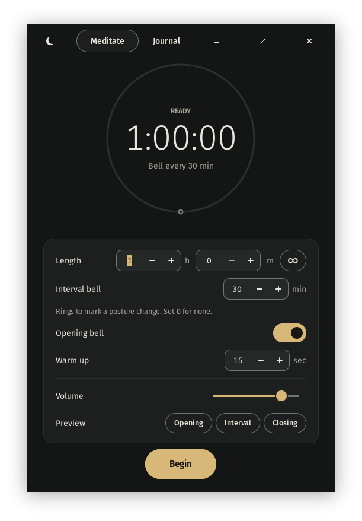

# Meditation Bell

A quiet desktop meditation timer for Linux, built for long sits: set any length
(or none), ring a bell at a regular interval as a posture-change reminder, and
keep a journal of how much you have meditated.



## Features

- **Any length, or ∞.** Hours and minutes, or no end at all: interval bells keep ringing until you stop.
- **Interval bells** at any number of minutes, plus separate opening and closing bells.
- **Warm up.** A short countdown after Begin (15 seconds by default) so you can settle before the opening bell.
- **Extra time.** When a timed meditation reaches its end, the closing bell rings and a "+m:ss" counter keeps going for as long as you choose to stay. Press End and pick what goes in the journal: the planned length, or the planned length plus the extra.
- **You decide what's saved.** Ending early asks whether to save or not (under a minute is never saved). The End dialog saves what it shows. Bells keep ringing while it's open, so a dialog opened by mistake can't silence the rest of a meditation; if it's answered after more than a minute, or after a bell or the planned end, it's shown again with the current numbers. If the laptop slept during the meditation, the dialog says so and offers to save only the time you were awake (otherwise sleep counts, since the timer keeps running through it).
- **Journal.** Today, last 7 and 30 days, all time, day streak, a 14-day chart and a list of meditations. Add a meditation by hand or delete one (a backup of the previous journal is kept).
- **Built for long sits.** Timing is based on a clock that keeps counting through suspend, so bells stay on schedule, and pauses are excluded. While a bell is still due, the laptop is kept from sleeping, and from idle-suspending when that would stop the bells; when no bell can ring (paused, extra time, or ∞ with no interval bell) it may sleep as usual. If it slept mid-meditation (or between a crash and carrying on) the app tells you, and you can save the meditation without that time. The meditation is checkpointed every 10 seconds (every minute while paused), and again when the system announces a shutdown, which doesn't end it in case the shutdown is cancelled. If the app closes unexpectedly (say the desktop restarts), opening it again within 15 minutes offers to carry on where the meditation is now, with any missed bell rung once; otherwise the meditation is recorded in the journal. Extra time stops counting after 4 hours in case the app was left running. Closing a terminal the app was started from doesn't end the meditation.
- **Hard to trip over.** A Begin that can't start (no length set) plays two soft tones, even with the volume at zero; starting with the volume at zero asks first. Clicking Pause or End doesn't leave keyboard focus on it, and focus is cleared when a meditation starts or you choose Keep meditating, so a stray key press doesn't pause or end anything.
- **Calm to look at.** Light and dark themes (follows the system, with a toggle), a dimmed view after 30 seconds that shows whole minutes ("45m"), and colour contrast that meets WCAG AA.

## Requirements

Python 3 with GTK 3 (PyGObject) and GStreamer. On Debian, Ubuntu or Pop!_OS:

```sh
sudo apt install python3-gi python3-gi-cairo gir1.2-gtk-3.0 gir1.2-gstreamer-1.0 \
    gstreamer1.0-plugins-good pulseaudio-utils
```

`pulseaudio-utils` provides `pactl`, used to notice when sound goes to a monitor
(whose screen must then stay on); without it the screen is simply kept on during a
meditation. Developed on Pop!_OS with the COSMIC desktop. It should run on any GTK 3 desktop;
theme-following and the keep-awake logic are written for COSMIC and fall back to
generic behaviour elsewhere.

## Run

```sh
python3 bell_timer.py
```

or `./install.sh` to add a launcher entry and a `bell-timer` command.

## Bells

| File | Used for | Source |
| --- | --- | --- |
| `start_bell.wav` | Opening bell | ["bell-meditation_cleaned.wav" by JetRye](https://freesound.org/s/140128/), CC0 |
| `end_bell.wav` | Closing bell | ["temple_bell_002.wav" by tec_studio](https://freesound.org/s/668647/), CC0 |
| `interval_bell.wav` | Interval bell | ["Bright Tibetan Bell Ding B Note - cleaner" by steaq](https://freesound.org/s/346328/), CC0 |

To use your own sounds, replace any of these files with one of the same name.

## Tests

```sh
sudo apt install python3-pytest libgtk-3-bin   # pytest, and broadwayd for headless windows
pytest                 # everything (about a minute)
pytest -m "not system" # skip the tests that use real audio, power and session services
```

The suite has unit tests (formatting, journal file handling, WCAG colour
contrast), integration tests that drive the real window with a fake clock
(bells, pause, warm-up, extra time, saving, crash recovery, the journal page,
accessibility, rendering every state in both themes), regression tests for bugs
fixed in the past, and system tests (decoding and playing each bell, the real
sleep lock and idle inhibitor, logout and crash handling of a real app process,
and the installer). Windows open on a private Broadway display when `broadwayd`
is installed (without it they open on your desktop, and the system tests run a
real meditation in a child process). Every test uses a temporary data folder, so
your journal is never touched.

## Your data

Everything stays on your machine, in `~/.local/share/bell-timer/`:
`sessions.jsonl` (one line per meditation), `config.json` (last settings),
`current.json` (a checkpoint while a meditation is running),
`sessions.jsonl.bak` (the journal before your last delete), `.lock` (so only one
copy of the app uses the folder at a time) and, only if a save ever fails,
`unsaved-*.json` files that are added to the journal at the next chance (at
launch or at the next Begin; if a carry-on question is asked, once you've
answered it by saving). A file that can't be read is kept under a new name
ending `.bad`, never deleted or overwritten. The folder is readable only by you. The app makes no network
connections.

Each journal line is a JSON object: `start`, `end`, `seconds` (the time saved),
`planned` (`null` for ∞), `interval`, `bells`, `completed` (the planned length
was reached; always false for ∞), and when they apply `extra_seconds` (extra time
included), `unsaved_extra_seconds` (extra time noted but not added, when the app
was closed by logout or a crash), `asleep_seconds` (laptop sleep during it),
`sleep_left_out` (that sleep isn't in `seconds`), `recovered` and `manual`. You
can edit the file by hand; deleting a meditation in the app leaves your other
lines exactly as written, even ones that aren't valid JSON or UTF-8.

## Licence

Code and `logo.png` (made for this project with an AI image generator): MIT, see
`LICENSE`. Bell recordings: CC0, by their authors above.
